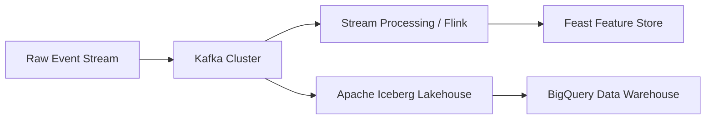

# Fault-Tolerant Data Pipelines Architecture

## 1. Ingestion & Transformation Topology

## 2. Ingestion Guarantees

- **Idempotent Partitioning:** Writes partitioned by ingestion timestamp with deduplication hashes.
- **Dead-Letter Queue:** Corrupt schema records routed to DLQ topic for automated diagnostics.
- **Backpressure Handling:** Reactive consumer scaling based on lag metrics.
