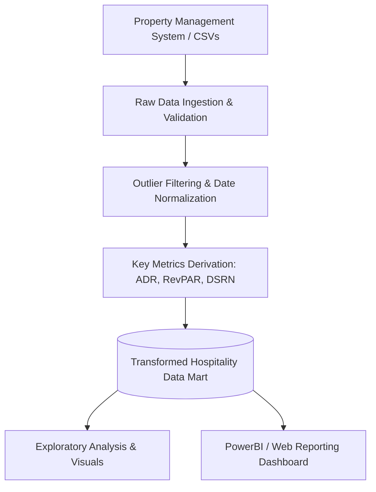

# Hospitality Analytics: System & Pipeline Architecture

**Course / Project:** `eda-in-hospitality-domain`  
**Platform:** Codebasics  
**Instructor:** Dhaval Patel  
**Category:** Business Intelligence & Exploratory Data Analysis  

---

## 1. End-to-End Analytics Workflow

---

## 2. Core Business Metric Formulas

| Metric | Full Form | Formula | Purpose |
| :--- | :--- | :--- | :--- |
| **RevPAR** | Revenue Per Available Room | `Total Revenue / Total Capacity` | Primary health indicator of hotel real estate |
| **ADR** | Average Daily Rate | `Total Room Revenue / Sold Rooms` | Measures pricing power and guest willingness to pay |
| **DSRN** | Daily Sellable Room Nights | `Count of operational available rooms per day` | Baseline capacity denominator |
| **Occupancy %** | Percentage of Utilized Rooms | `(Successful Check-ins / Total Capacity) * 100` | Demand utilization rate |

---

## 3. Data Hygiene & Outlier Rules

- **Negative / Zero Capacities:** Exclude records where capacity <= 0.
- **Guest Overflows:** Filter out bookings where guests exceed room type upper limits (e.g., > 4 in Standard rooms).
- **Rate Glitches:** Cap extreme ADR deviations (> 3x property median) flagged as system entry errors.
