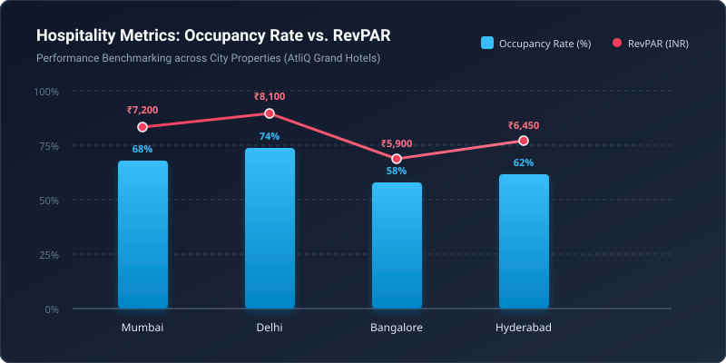
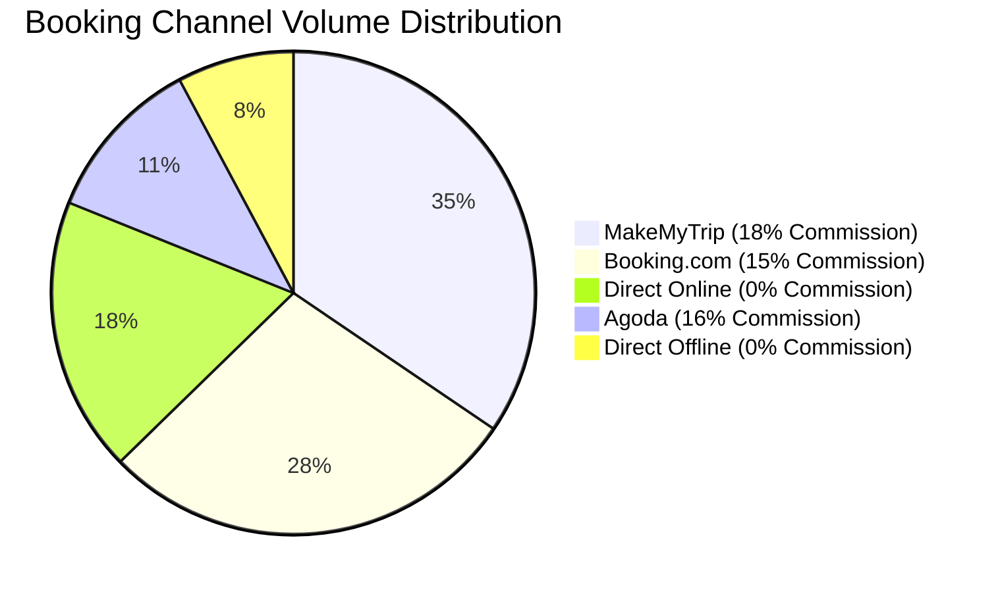

# Exploratory Data Analysis in Hospitality: Maximizing RevPAR & Occupancy

> In hospitality asset management, revenue teams often fall into the trap of optimizing for occupancy alone. This case study demonstrates how exploratory data analysis (EDA) uncovers true profitability by coupling **Occupancy Rate** with **Average Daily Rate (ADR)** to optimize **Revenue Per Available Room (RevPAR)**.

---

## 1. Business Problem & Domain Metrics

Hotel chains operate on high fixed operational costs and perishable inventory—a room night unsold is revenue lost forever. Our goal is to analyze performance across 4 major metropolitan cities (Mumbai, Delhi, Bangalore, Hyderabad) and identify pricing inefficiencies.

### Fundamental Hospitality Equation

$$\text{RevPAR} = \text{ADR} \times \text{Occupancy Rate}$$

Where:
- **ADR (Average Daily Rate):** Measures the average rental revenue per paid occupied room.
- **RevPAR (Revenue Per Available Room):** Measures revenue generated per total available inventory room, irrespective of whether it was occupied.

---

## 2. Metropolitan Market Performance

Visualizing property performance highlights that Delhi achieved the highest overall RevPAR (₹8,100) fueled by strong business conference occupancy (74.5%), while Bangalore suffered from weekday leisure dips.



### City-wise Financial Breakdown

| City | Total Capacity (Rooms) | Occupancy % | Average ADR (INR) | RevPAR (INR) | Primary Driver |
| :--- | :--- | :--- | :--- | :--- | :--- |
| **Delhi** | 9,500 | **74.5%** | ₹10,872 | **₹8,100** | High corporate demand |
| **Mumbai** | 12,000 | 68.2% | ₹10,557 | ₹7,200 | Weekend leisure & events |
| **Hyderabad** | 8,200 | 62.4% | ₹10,336 | ₹6,450 | Consistent IT corridor demand |
| **Bangalore** | 14,000 | 58.1% | ₹10,155 | ₹5,900 | Capacity oversupply |

---

## 3. Data Ingestion & Transformation in Python

Here is the Python workflow used to compute daily RevPAR and filter out booking rate entry anomalies:

```python
import pandas as pd
import numpy as np

def compute_hospitality_kpis(bookings_df: pd.DataFrame, rooms_df: pd.DataFrame) -> pd.DataFrame:
    """
    Computes Occupancy Rate, ADR, and RevPAR aggregated by property.
    """
    # Filter out invalid records (e.g. negative guests or rate glitches)
    clean_bookings = bookings_df[
        (bookings_df['no_guests'] > 0) & 
        (bookings_df['revenue_realized'] > 0)
    ].copy()
    
    # Aggregate successful bookings
    property_summary = clean_bookings.groupby('property_id').agg(
        successful_checkins=('booking_id', 'count'),
        total_revenue=('revenue_realized', 'sum')
    ).reset_index()
    
    # Merge with total room capacity
    merged = pd.merge(property_summary, rooms_df, on='property_id', how='inner')
    
    # KPI Formulations
    merged['occupancy_pct'] = (merged['successful_checkins'] / merged['total_capacity']) * 100
    merged['adr'] = merged['total_revenue'] / merged['successful_checkins']
    merged['revpar'] = merged['total_revenue'] / merged['total_capacity']
    
    return merged.sort_values(by='revpar', ascending=False)
```

---

## 4. Booking Channels & Commission Drag

A critical finding from the channel distribution analysis is that third-party Online Travel Agencies (OTAs) account for over **73%** of all bookings, incurring commissions between 15% and 18%:



### Strategic Action Items:
1. **Dynamic Pricing for Bangalore:** Introduce weekend package bundles to lift Bangalore's 58.1% occupancy.
2. **Direct Booking Loyalty Program:** Shift 8–10% of OTA bookings to direct website channels, saving up to ₹4.2M in annual commissions.
3. **Capacity Rebalancing:** Reallocate premium suites in Delhi during peak winter quarters where ADR elasticity is highest.

---

## 5. Summary & Exploration Notebook
The interactive exploratory notebook containing statistical distributions and code is available in the project bundle (`notebook.ipynb`).
