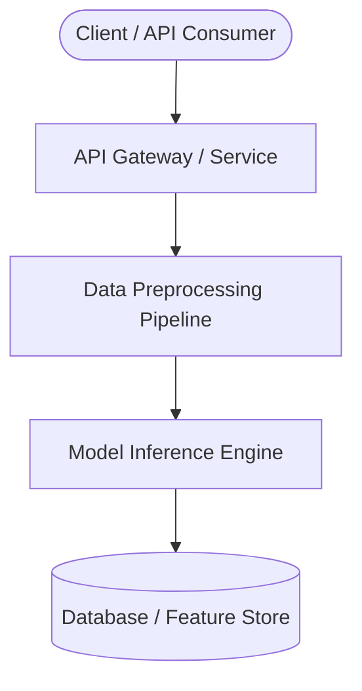

# System Architecture & Technical Specifications

**Project:** spam-detection-classifier  
**Course:** ml-foundations  
**Date:** 2026-10-21

---

## 1. High-Level Flowchart

---

## 2. Technical Decisions & ADR Notes

- **Language / Framework:** Python, Scikit-Learn, FastAPI
- **Data Ingestion Strategy:**
- **Inference Strategy:**
- **Observability & Logging:**
