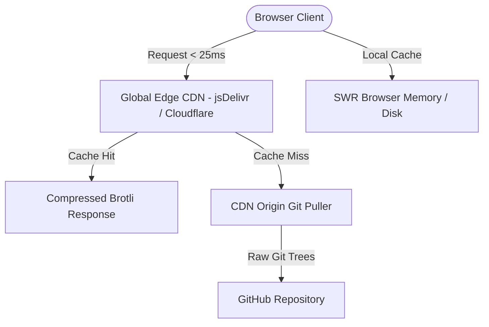

# Systems Architecture: Latency & CDN Resiliency Blueprint

## 1. System Topology Overview

## 2. Component Specifications

- **Edge Tier:** jsDelivr multi-CDN mesh (300+ PoPs globally) providing Brotli compression and SSL termination.
- **Client Tier:** SWR client library handling client-side memoization and background revalidation.
- **Renderer:** Shiki TextMate grammar syntax highlighter running non-editable code rendering.
